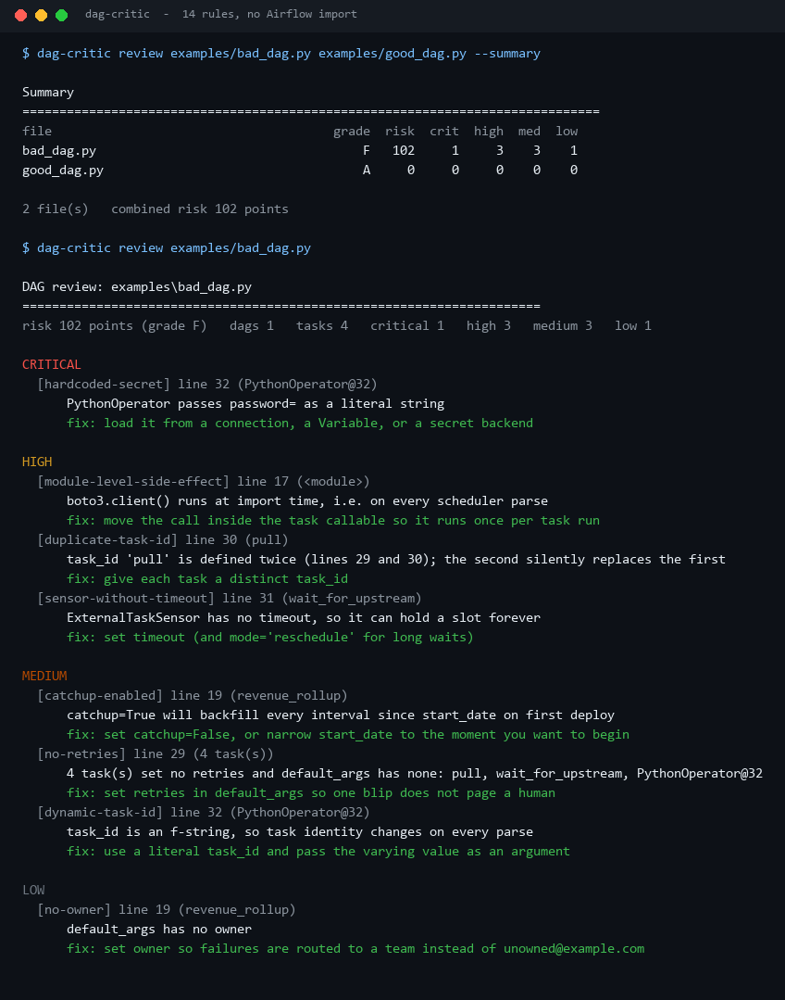
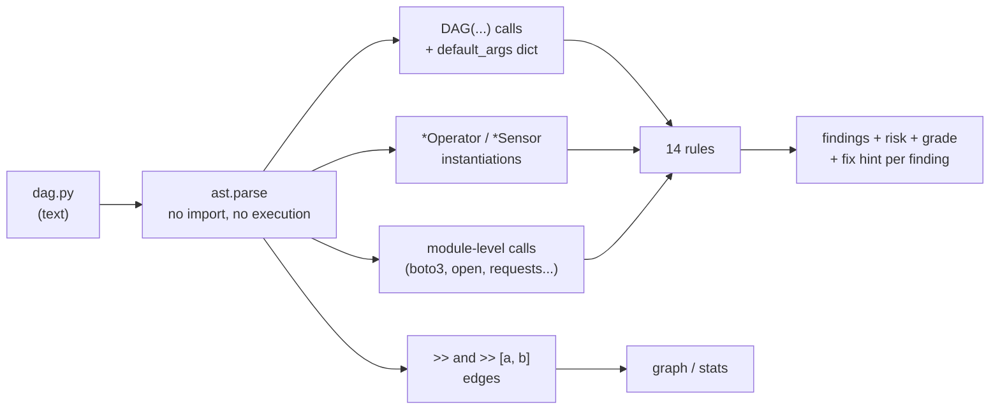
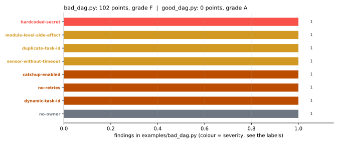
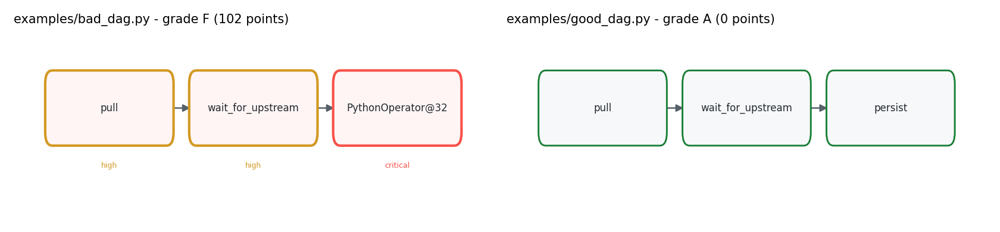
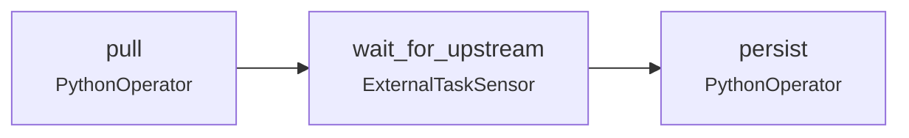

# Airflow-DAG-Critic

**Reviews Airflow DAG files for the mistakes that survive code review - without importing Airflow, executing the file, or connecting to a scheduler.**

`sensor-without-timeout`, `catchup=True`, a credential pasted into an operator, a `boto3.client()`
at module level, the same `task_id` twice: none of these fail a test, and all of them page
someone at 3am.



Every number above comes from `scripts/render_assets.py` running the tool on the two example
files in this repository.

---

## Table of contents

- [Why static review, not a linter](#why-static-review-not-a-linter)
- [How it reads a DAG without Airflow](#how-it-reads-a-dag-without-airflow)
- [The rules, and what each one costs](#the-rules-and-what-each-one-costs)
- [Before and after](#before-and-after)
- [The graph view](#the-graph-view)
- [Install and run](#install-and-run)
- [Commands](#commands)
- [Exit codes](#exit-codes)
- [Design notes and limits](#design-notes-and-limits)
- [Tests](#tests)
- [License](#license)

---

## Why static review, not a linter

`ruff` and `flake8` check Python. `airflow dags list-import-errors` tells you the file imports.
Neither tells you that:

- the sensor has **no timeout**, so it waits forever and holds a worker slot;
- `catchup=True` will try to backfill **every interval since `start_date`** the moment it is
  unpaused;
- `boto3.client()` at import time runs on **every scheduler parse**, not once per task run;
- `task_id="pull"` appears twice, so the second task silently replaces the first and the
  dependency graph quietly loses a node.

Those are the findings in this tool. They are all visible in the syntax tree, which means they
can be found in CI in milliseconds, before anything is deployed.

## How it reads a DAG without Airflow



`ast.parse` is the whole trick. The file is data, not code: a DAG file is a set of `DAG(...)`
calls, operator instantiations and `>>` edges. Reading it as syntax means:

- **no Airflow install** - works in a plain Python CI step, or on a laptop;
- **no side effects** - a file with `boto3.client(...)` at import time is exactly the file you
  do *not* want to import in a review job;
- **no scheduler guessing** - `if` branches and `try` blocks are visible as structure instead of
  being flattened by whatever the interpreter happened to do.

Operator variables are mapped back to their `task_id`, so `pull >> wait >> persist` is reported
with the names Airflow uses, not the local variable names.

## The rules, and what each one costs

| Severity | Code | Trigger | Points |
| --- | --- | --- | ---: |
| 🔴 critical | `hardcoded-secret` | `password=`, `token=`, `secret=`, `api_key=` … given a literal string | 30 |
| 🟠 high | `no-dag` | the file defines no `DAG()` at all | 15 |
| 🟠 high | `sensor-without-timeout` | a `*Sensor` with no `timeout` | 15 |
| 🟠 high | `duplicate-task-id` | two tasks share a `task_id`; the second overwrites the first | 15 |
| 🟠 high | `module-level-side-effect` | `boto3.client`, `requests.*`, `open`, `psycopg2.connect`, `subprocess.*` … outside a function | 15 |
| 🟡 medium | `no-start-date` | no `start_date` on the DAG or in `default_args` | 8 |
| 🟡 medium | `catchup-enabled` | `catchup=True` | 8 |
| 🟡 medium | `catchup-default` | `catchup` not set, so it defaults to `True` | 8 |
| 🟡 medium | `dynamic-task-id` | `task_id=f"..."` - identity changes on every parse | 8 |
| 🟡 medium | `dynamic-dag-id` | `dag_id=f"..."` - same problem, one level up | 8 |
| 🟡 medium | `missing-task-id` | operator instantiated without `task_id` | 8 |
| 🟡 medium | `no-retries` | tasks set no retries and `default_args` has none (reported once per file) | 8 |
| ⚪ low | `no-schedule` | no `schedule` / `schedule_interval` | 3 |
| ⚪ low | `no-owner` | `default_args` has no `owner` | 3 |

Grades: `A` = 0, `B` ≤ 10, `C` ≤ 30, `D` ≤ 60, `F` > 60 points.
`--fail-on` defaults to `high`, so CI fails on critical and high findings only.

Two deliberate non-findings:

- **dynamic ids are not also flagged as duplicates.** Two f-string `task_id`s are not the same
  task; the critic cannot evaluate the f-string, so calling it a duplicate would be an artefact.
- **`no-retries` is aggregated.** Twenty tasks without retries is one problem, not twenty.

## Before and after



| | `examples/bad_dag.py` | `examples/good_dag.py` |
| --- | ---: | ---: |
| Risk | **102 points** | **0 points** |
| Grade | **F** | **A** |
| Critical / high / medium / low | 1 / 3 / 3 / 1 | 0 / 0 / 0 / 0 |
| DAGs / tasks parsed | 1 / 4 | 1 / 3 |

The two files are the same pipeline: fetch revenue, wait for upstream, persist. The diff is
ownership, retries, a timeout, `catchup=False`, no import-time client, a stable `task_id`, and a
credential read from a connection instead of a literal.

The one finding in `bad_dag.py` that people usually argue about is `module-level-side-effect`.
The argument is "it only runs once". It does not: the scheduler re-parses DAG files repeatedly,
so a client built at module scope is rebuilt every parse - and any network call at that point
delays the parse loop for *every* DAG in the deployment, not just this one.

## The graph view



`dag-critic graph` prints the same graph as Mermaid, so a review comment can include the picture:

```
$ dag-critic graph examples/good_dag.py

```

Nodes with no incoming or outgoing edge are marked `orphan` with a dashed border - in a real
DAG those are the tasks that were wired up wrong and never run.

## Install and run

Standard library only.

```bash
python -m pip install -e ".[dev]"
dag-critic review path/to/dag.py
```

From a checkout without installing:

```bash
PYTHONPATH=src python -m airflow_dag_critic review examples/bad_dag.py
```

## Commands

| Command | What it does |
| --- | --- |
| `review PATH... [--format text\|markdown\|json] [--fail-on high] [--summary]` | score one or more files |
| `graph PATH` | print the task graph as Mermaid |
| `stats PATH...` | DAG/task counts without judging anything |
| `rules` | print the table above |

```bash
# CI gate: fail the build on anything critical or high
dag-critic review dags/*.py --fail-on high

# PR comment
dag-critic review dags/nightly.py --format markdown

# whole-repo dashboard
dag-critic review dags/*.py --summary
```

## Exit codes

| Code | Meaning |
| ---: | --- |
| 0 | no findings at or above `--fail-on` |
| 1 | findings at or above `--fail-on` |
| 2 | unreadable file, or the file is not valid Python |

## Design notes and limits

- **Static only.** A DAG whose tasks are generated in a loop is reviewed as the loop, not as the
  forty tasks it will produce at runtime. `dynamic-task-id` is the finding that tells you the
  review is operating at the wrong level.
- **Airflow version drift.** `schedule_interval` and `schedule` are both accepted; `timetable`
  counts as scheduled. Nothing here depends on a specific Airflow release.
- **Secrets rule is a keyword match**, not entropy analysis. It looks for
  `password`/`secret`/`token`/`api_key`/`aws_secret_access_key` with a non-empty literal. A
  variable named `secret_name="prod/db"` will be flagged, and you should rename it to
  `secret_id` - the message never prints the value, only the keyword.
- **No `TaskGroup` awareness.** Grouping is cosmetic for these rules; each operator is judged on
  its own arguments.
- **Not a substitute for a cluster linter.** Airflow's own
  `airflow dags reserialize`/`list-import-errors` still belongs in CI. This tool answers
  "should a human look at this file", not "will it import".

## Tests

```bash
PYTHONPATH=src python -m pytest -q     # 50 passed
python -m ruff check .                 # All checks passed!
```

50 tests cover the AST extraction (DAGs, keywords, `default_args` resolution, `>>` chains and
branches, module-level side effects, f-string ids), each rule's trigger and non-trigger, sort
order, and every CLI command including the three exit codes.

## License

MIT. See [LICENSE](LICENSE).

---

<sub>Screenshots, charts and the graph are generated by `scripts/render_assets.py` from this
repository's own output. The dummy password in `examples/bad_dag.py` is the string
`not-a-real-password` and exists only to trip the rule.</sub>
